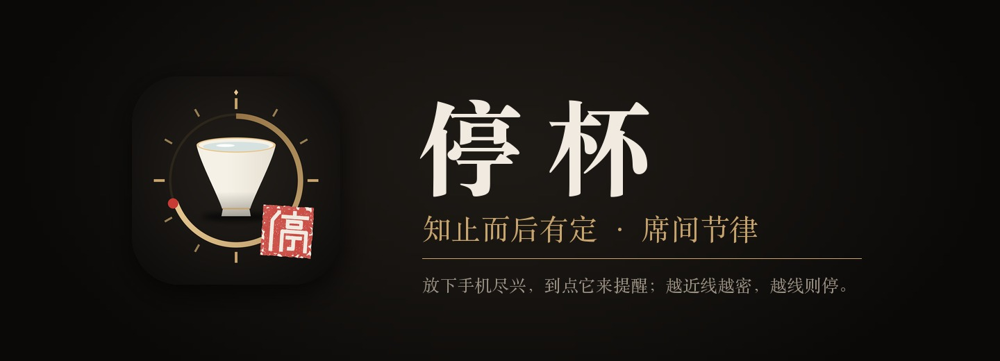
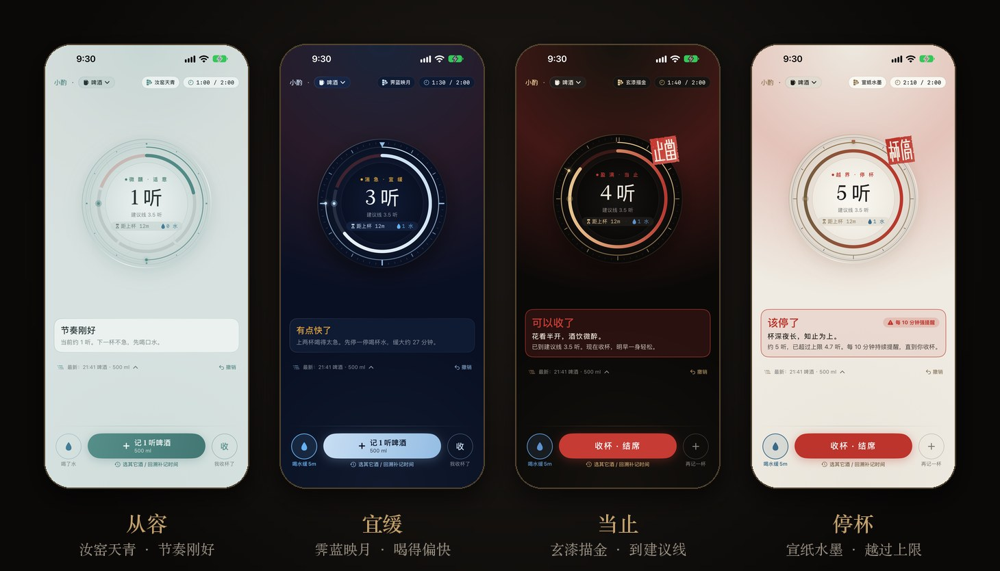
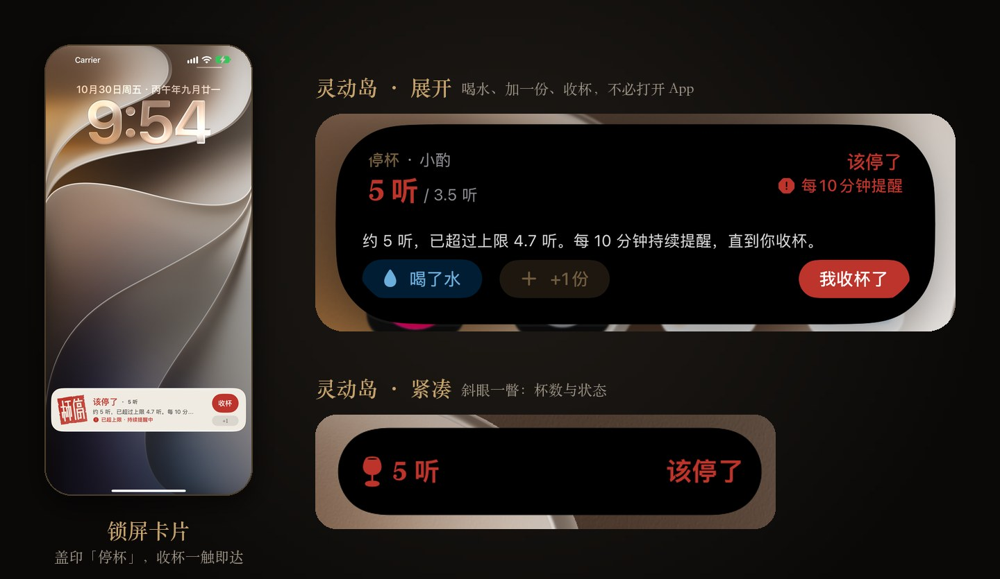
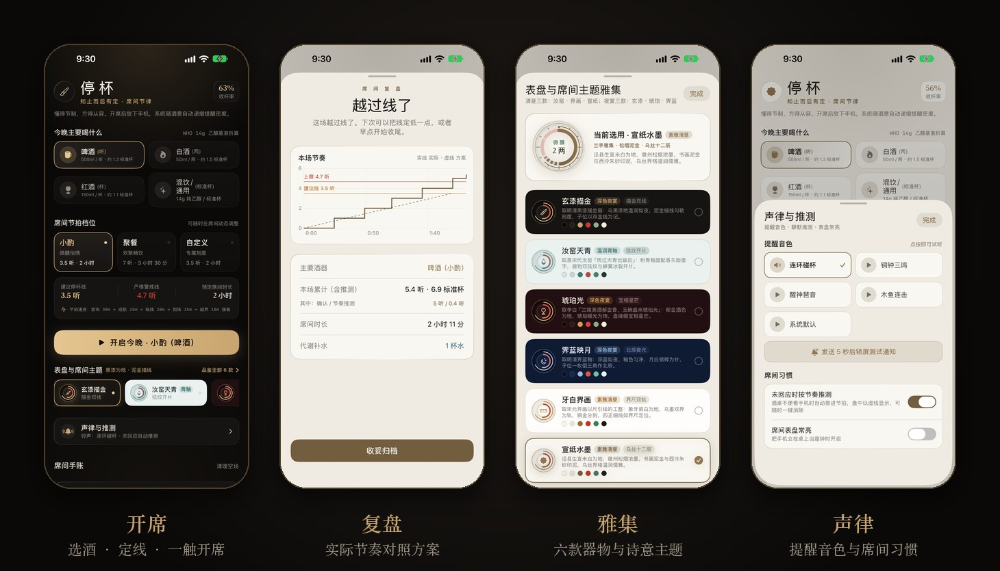

<p align="center">
  
</p>

<p align="center">
  
  <a href="https://github.com/jhzhang09/TingBei/actions/workflows/ci.yml"></a>
  
  
  
  
</p>

<p align="center"><i>知止而后有定，定而后能静。——《大学》</i></p>

**停杯**是一款原生 iOS 饮酒节奏副驾。开席后把手机放下，它按你定下的线主动提醒：越接近建议线，提醒越密；越过上限，便在表盘上盖一方朱砂印——**停杯**。

---

## 缘起

酒桌上失去节奏，往往不是因为不知道该停，而是没人在恰当的时候提醒一声。说教式的戒酒工具扫兴，逐杯手动记录又不现实。停杯想做的，是一位安静、克制、懂分寸的同席：

- **以实物计量，以标准杯折算**：按啤酒「听」、白酒「两」、红酒「杯」来记，底层统一按世界卫生组织的标准杯（14 克纯乙醇）折算比较。
- **主动提醒为主，手动记录为辅**：不回应时，按你方案的节奏推测杯数（盘中以虚线标出），事后可逐条确认或消除，不至于醉后无迹可寻。
- **越近线越密，越线则停**：提醒间隔从 30 分钟逐级收紧到 10 分钟；到线、越线时界面随之转为朱砂色，收杯成为最醒目的按钮。
- **不必解锁**：锁屏通知、锁屏卡片与灵动岛上，都可以直接「喝了 / 还没喝 / 喝水 / 收杯」。

> 标准杯只是估算，用来比较一场饮酒的量，**不代表血液酒精浓度，也不能作为是否可以驾驶的依据**。

---

## 四时之境

同一张表盘，随酒意走过四种状态。每种状态配一款主题，只为展示；实际可任选主题。

<p align="center"></p>

| 档位 | 触发条件 | 下次提醒 | 界面 |
| :-- | :-- | :-- | :-- |
| 轻声 | 开局，进度不足 35% | 30 分钟后 | 「初酌 · 从容」 |
| 留意 | 进度 35%～70% | 25 分钟后 | 「微醺 · 适意」 |
| 收尾 | 进度达 70% | 20 分钟后 | 状态色转为警示色 |
| 到线 | 达到建议线，或到达预定时长 | 15 分钟后 | 盖「当止」印，收杯升为主按钮 |
| 越线 | 超过上限，或超时 30 分钟 | 每 10 分钟，直到收杯 | 盖「停杯」印，锁屏卡片同步转红 |

进度取「杯量 / 建议线」与「时长 / 预定时长」中较大的一项。两杯间隔过短（按酒精量加权）会提示「湍急 · 宜缓」，期间每喝一杯水可折抵 5 分钟冷却。

---

## 不必解锁

<p align="center"></p>

- **锁屏通知**：长按提醒即可选择「喝了一份 / 还没喝 / 我收杯了」，不必解锁；App 被系统结束后也能处理。
- **锁屏卡片与灵动岛**：实线为已确认杯数、虚线为推测；下次提醒倒计时到点即显示「待回应」。
- **快捷动作**：灵动岛展开态可直接「喝了水 / +1 份 / 我收杯了」，通过 `tingbei://` 深链响应。

---

## 六款主题

每款主题取一种中国器物、工艺或诗句，配色与表盘纹样都对得上名字。

| 主题 | 取意 | 表盘 |
| :-- | :-- | :-- |
| 玄漆描金 | 明清黑漆描金器：乌黑漆地，泥金细线 | 描金双线 |
| 汝窑天青 | 宋代汝窑「雨过天青云破处」，冰裂开片 | 弦纹开片 |
| 琥珀光 | 李白「兰陵美酒郁金香，玉碗盛来琥珀光」 | 宝相星芒 |
| 霁蓝映月 | 明清霁蓝釉，月白银辉为针 | 北辰夜光 |
| 牙白界画 | 宋元界画以尺引线，象牙瓷白为地 | 界尺双轨 |
| 宣纸水墨 | 泾县生宣、徽州松烟墨与西泠朱砂印 | 乌丝十二辰 |

到线、越线时盖下的「当止」「停杯」是汉印缪篆白文印，字形按笔画坐标绘制，不依赖字体。

---

## 更多界面

<p align="center"></p>

- **开席**：选酒种与方案（小酌、聚餐或自定义）后一触开席。自定义按整数「听 / 两 / 杯」调整建议线与上限，时长以 15 分钟为步进。
- **复盘**：结席后给出收在线内 / 到线就收 / 越过线了的结论，并以阶梯曲线对照实际节奏与方案节奏。
- **雅集**：六款主题随时切换，席间也可以换。
- **声律**：四款定制提醒音（连环碰杯、铜钟三鸣、醒神琶音、木鱼连击）点按即可试听；可发送锁屏测试通知；可开关静默推测与表盘常亮。
- **其他**：回溯补记（刚才 / 10 / 20 / 30 分钟前）、撤销上一条、席间手账（保留最近 50 场）与收杯率。

---

## 已知限制

- **时效性通知**：代码已把提醒设为时效性级别，但开启这项能力需要付费的 Apple Developer Program 账号；免费个人团队签名时不可用。在此之前，开着专注模式时提醒不会响铃，可在「设置 → 专注模式」中把「停杯」加入允许的 App。静音模式下任何通知都不会响铃。
- **与 Mac 同步通知**：开启 iPhone 镜像后，Mac 会自动接收 iPhone 的通知与实时活动。实际使用中发现，这时 iPhone 上的提示音会时有时无；若希望手机每次都响，可在 iPhone「设置 → 通知 → 停杯」中关闭「在 Mac 上显示」。
- **标准杯换算**：按常见酒度估算（啤酒 500 ml ≈ 18 g、白酒一两 ≈ 21 g、红酒 150 ml ≈ 15 g 乙醇），与实际酒款可能有出入。

---

## 工程结构

```
TingBei/
├── TingBei/
│   ├── TingBeiApp.swift          App 入口、通知代理、tingbei:// 深链
│   ├── Pace.swift                节奏算法：标准杯折算、提醒阶梯、静默推测、状态机自检
│   ├── SessionStore.swift        会话状态、通知排期、实时活动生命周期、本地持久化
│   ├── TingBeiAttributes.swift   实时活动数据模型（App 与小组件共享）
│   ├── ThemePalette.swift        六款主题配色表（App 与小组件共享）
│   ├── SealGlyphs.swift          汉印篆字笔画与朱砂印绘制（App 与小组件共享）
│   ├── Theme.swift               当前主题与派生色
│   ├── Views.swift               根视图与氛围背景
│   ├── HomeView.swift            首页
│   ├── SessionView.swift         会话页：表盘、印章、状态卡、操作区
│   ├── Sheets.swift              补记、时间轴、复盘曲线、声律设置、主题雅集
│   ├── Components.swift          通用组件
│   └── Sounds/                   四款提醒音（.caf）
├── TingBeiWidgets/               锁屏卡片与灵动岛
├── scripts/                      App 图标与印章的生成脚本（Python + Pillow）
├── docs/images/                  README 配图
├── renew.sh                      局域网自动续签脚本
└── .renew.env.example            续签脚本本地配置模板
```

---

## 构建与自检

需要 Xcode 27 与 iOS 27 SDK；真机运行需 iOS 27 及以上，带灵动岛的机型体验最完整。

```bash
# 状态机自检（无需模拟器）
swift -DPACE_CHECKS TingBei/Pace.swift

# 构建主 App 与小组件（不签名）
xcodebuild -project TingBei.xcodeproj -scheme TingBei \
  -destination 'generic/platform=iOS Simulator' CODE_SIGNING_ALLOWED=NO build
```

推送到 `main` 或向 `main` 发起 PR 时，CI 会运行上述两步。

### 自动续签

免费开发者账号的签名每 7 天过期。`renew.sh` 可配合 LaunchAgent 定时运行：重新编译签名，并通过局域网或数据线安装到手机，失败时会推送通知唤醒手机后重试。

Telegram 推送所需的 Bot 令牌与 Chat ID 放在项目根目录的 `.renew.env`（已被 git 忽略）。首次使用时复制 `.renew.env.example` 为 `.renew.env` 后填写；不配置时只跳过推送，不影响续签。

---

## 许可

[MIT License](LICENSE)
