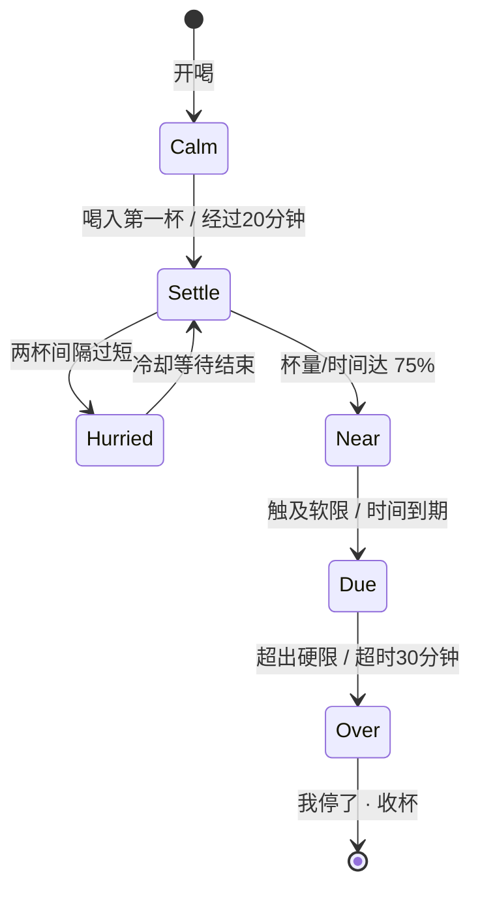

# 停杯 (TingBei)

<p align="left">
  
  
  
  
  
</p>

> **“懂得节制，方得从容。”**  
> 一款专注饮酒节奏管理、节制适度饮酒（Mindful Drinking / Pacing）的原生 iOS 应用。

---

## 🌟 产品哲学与设计理念

喝酒往往是在欢愉或社交氛围中逐渐失去节奏。「停杯」不是冰冷的禁酒工具，也不是说教式的健康警报，而是一位**沉静、温和、克制**的酒桌副驾：

1. **客观度量，不凭感觉**：引入世界卫生组织（WHO）通用的 **「标准杯」（Standard Drink）** 换算标准（以 14 克纯乙醇为基准），不论啤酒、葡萄酒、白酒或自调鸡尾酒，都能归一化比较。
2. **三维独立约束，立体守护**：
   - **杯量线**：设定软限（建议收杯）与硬限（严肃警戒）。
   - **单场时长**：设定预定时长，超时自动升档提醒。
   - **杯间间隔**：约束两杯之间的健康休息间隔，防止急饮冲头。
3. **心理阻尼设计（Friction Design）**：
   - 越线前，记杯只需轻触；
   - 一旦越过硬限警戒线，主操作变为醒目的“我停了”，若想继续记杯必须**长按 2 秒**。用物理交互阻力抑制冲动续杯。
4. **倡导水酒穿插（Hydration Pacing）**：
   - 醒目的“喝了水”按钮与补水统计徽章，鼓励每喝一杯酒就及时补充一杯水，给身体代谢留足缓冲。
5. **暗夜微醺美学**：
   - 采用深咖黑底（`#140E0A`）、暖琥珀金、鼠尾草绿与波尔多酒红。
   - 顶部光晕背景（`NightBackground`）随饮酒节奏紧张度（Heat）自适应渐变呼吸。

---

## 核心算法与状态机 (`Pace.swift`)



### 六档动态节拍 (Cue)

| 档位 | 状态 | 触发条件 | 视觉与反馈 |
| :--- | :--- | :--- | :--- |
| **0. Calm** | 慢慢喝 | 会话刚创建，尚未开始或刚入口 | 鼠尾草绿，安静沉稳 |
| **1. Settle** | 先别急着续 | 正常进度，提示补充水分或记杯 | 鼠尾草绿，轻度脉冲 |
| **2. Hurried** | 喝得有点快 | 两杯之间间隔短于设定值（如短于 25 分钟） | 琥珀金，警示震动，**显示杯间剩余冷却倒计时** |
| **3. Near** | 快到线了 | 杯量达软限 70% 或时间过 75% | 琥珀金，提前预告收尾 |
| **4. Due** | 可以停了 | 触及建议目标软限或预定时长到达 | 酒红色，建议结束本场 |
| **5. Over** | 停一下 | 超过硬限警戒线或超时半小时 | 深酒红，强警示震动，**开启2秒长按防冲动按钮** |

---

## 📱 核心功能特性

- **多模式预设与自选酒饮**：
  - 内置经典方案：**小酌**（2 标准杯 · 90 分钟）、**聚餐**（4 标准杯 · 3 小时）。
  - 支持自选酒饮计算：输入任意酒名、滑动调整容量（20ml~1000ml）与酒精度（1%~65%），实时折算酒精克数。
- **动态仪表盘**：
  - 环形标准杯双刻度进度圈（软限刻度 + 超限虚线刻度）。
  - 实时已喝时长与预定时长胶囊进度条。
- **智能离屏排期通知**：
  - 锁屏后通过 `UserNotifications` 自动预排最多 20 条精准提醒（间隔提醒、到期提醒、超时提醒），不错过任何收杯节点。
- **原生触感反馈**：
  - 基于 SwiftUI 原生 `.sensoryFeedback` 声明式分级驱动（轻触、警告、强震、成功）。
- **签名倒计时指示器**：
  - 针对个人自签名应用，直接在主界面底部显示证书剩余有效天数（`🟢 签名剩余 X 天 · 自动续期保护中`）。
- **纯原生零依赖**：
  - 基于 Swift 6 / SwiftUI，无任何 CocoaPods / SPM 外部依赖，体积极致轻巧，秒级编译。

---

## 🔄 局域网自动化无感续签系统 (0 成本永久运行)

为了免去免费个人 Apple ID 开发者证书 **7 天过期** 的烦恼，且**无需在手机上安装任何冲突 VPN 或第三方自签名工具（如 SideStore/AltStore）**，本项目内置了一套 **Mac 局域网自动化无线静默续签方案**：

```
                    ┌─────────────────────────┐
                    │      macOS 局域网        │
                    │   LaunchAgent 守护服务   │
                    └────────────┬────────────┘
                                 │ 每天定时检查
                                 ▼
                    ┌─────────────────────────┐
                    │       renew.sh          │
                    │   检测 iPhone 是否在网   │
                    └────────────┬────────────┘
                                 │ 在线
                                 ▼
                    ┌─────────────────────────┐
                    │  xcodebuild 增量编译     │
                    │  devicectl 无线推送安装  │
                    └────────────┬────────────┘
                                 │ 成功
                                 ▼
                    ┌─────────────────────────┐
                    │  iPhone 有效期重置 7 天  │
                    │  Mac 右上角弹出成功通知  │
                    └─────────────────────────┘
```

### 1. 核心自动化组件
* **`renew.sh`**：自动识别连接（USB 或 Wi-Fi 局域网）的真机，一键执行增量编译、签名打包并无线推送。
* **`LaunchAgent` 守护进程**：注册于 macOS 系统的后台任务，每日定时唤醒，静默续签，不弹窗不打扰。
* **快捷指令（Apple Shortcuts）支持**：支持随时随地在 Mac 菜单栏或呼叫 Siri 一键手动重签。

---

## 🛠️ 项目结构

```
TingBei/
├── TingBei/
│   ├── TingBeiApp.swift      # 应用程序入口与本地通知前台呈现配置
│   ├── Pace.swift            # 核心业务算法：标准杯折算、节奏评估引擎、状态机与单元自检
│   ├── SessionStore.swift    # 全局状态管理：@Observable 驱动、持久化存储、签名解析、触觉分发
│   ├── Views.swift           # 界面层：暗夜主题、仪表盘、长按防冲动按钮、自选酒饮面板、历史复盘
│   └── Assets.xcassets       # 配色（AccentColor、LaunchBackground）与矢量图标
├── TingBei.xcodeproj         # Xcode 工程配置（Target: iOS 27.0+）
├── renew.sh                  # 自动化增量构建与无线局域网真机安装脚本
└── README.md                 # 项目完整文档
```

---

## 🚀 编译与运行要求

* **macOS**：macOS 15.0+
* **Xcode**：Xcode 16.0+（支持 iOS 17.0+ / 27.0+ SDK）
* **设备支持**：iPhone（iOS 17.0 或更高版本）

### 命令行编译

```bash
# 运行 Debug 编译
xcodebuild -project TingBei.xcodeproj -scheme TingBei -destination 'generic/platform=iOS' build

# 运行独立状态机单元自测试
swift -DPACE_CHECKS TingBei/Pace.swift
```

---

## 📄 开源许可

本项目遵循 [MIT License](LICENSE) 开源。
