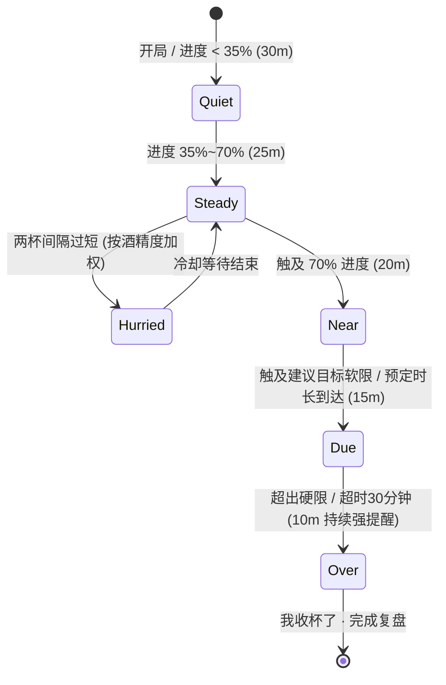

# 停杯 (TingBei)

<p align="left">
  
  
  
  
  
  
  
  
</p>

> **“懂得节制，方得从容。”**  
> 一款专注饮酒节奏管理、节制适度饮酒（Mindful Drinking / Pacing）的高端原生 iOS 应用。

---

## 🌟 产品哲学与设计理念

喝酒往往是在欢愉或社交氛围中逐渐失去节奏。传统的禁酒工具充满冷冰冰的说教，且往往要求用户每次都掏出手机手动记杯——在真实的酒桌上，这不仅繁琐，而且极为扫兴。

「停杯」是一位**沉静、温和、克制**的酒桌副驾：

1. **客观度量，不凭感觉**：引入世界卫生组织（WHO）通用的 **「标准杯」（Standard Drink）** 换算标准（以 14 克纯乙醇为基准），不论啤酒、葡萄酒、白酒或自调鸡尾酒，都能归一化比较。
2. **主动提醒为主，手动记录为辅**：开喝后放下手机即可。系统按你预定的节奏主动提醒；酒桌不便看手机时，系统会自动标记「**节奏估算**」，避免醉酒断片后无迹可寻。
3. **阶梯式紧迫感（Escalating Urgency）**：随着时间推移与摄入量逼近警戒线，提醒的**频率按等差阶梯递增、烈度加剧**（从 30 分钟逐步缩短至 10 分钟高频催促，伴随强物理震动与突破专注模式的时效性横幅），真正在彻底醉酒前把人拉住。
4. **锁屏免解锁互动（Actionable Notification & Deep Links）**：收到推送长按即可在锁屏一键确认「喝了一杯 / 还没喝 / 我收杯了」，无需解锁屏幕。
5. **暗夜黑金腕表美学（Night Champagne & Horology Design）**：
   - 采用纯粹暗夜微暖黑（`#0A0908`）、香槟金（`#C9A96E`）与波尔多酒红。
   - 界面灵感源于经典高端腕表与酒标：外圈流逝时间，内圈标准杯刻度，中央宋体大数字。

---

## 🏝️ 灵动岛与实时活动 (Live Activity & Dynamic Island)

引入 ActivityKit 原生支持，无论是锁屏还是退至桌面，随时斜眼一瞥即可掌握节奏：

```
                    ┌─────────────────────────┐
                    │  🍸 2.0  (紧凑左)       │  实时杯数（超限变红）
                    │  22:30  (紧凑右)       │  下次提醒倒计时
                    └────────────┬────────────┘
                                 │ 长按展开
                                 ▼
         ┌─────────────────────────────────────────────────┐
         │ 停杯 · 小酌                  快到线了            │
         │ 2.0 / 2杯 (含估算)          下次提醒 22:30       │
         │ ─────────────────────────────────────────────── │
         │ 这杯就当最后一杯，给身体一点代谢时间。          │
         │                                                 │
         │ [ 💧 喝了水 ]    [ ＋1杯 ]        [ 我停了 ]     │
         └─────────────────────────────────────────────────┘
```

- **全天候显示（Always-On Display）**：锁屏时常驻沉浸式黑金小表盘，免解锁掌握当前进度。
- **免进 App 快捷动作**：在灵动岛直接轻触 `喝了水`、`+1杯` 或 `我停了`，通过 `tingbei://` 原生 URL Schemes 瞬间响应。

---

## 📈 动态提醒与状态机 (`Pace.swift`)



### 五级等差动态提醒阶梯

| 档位 | 状态 | 触发条件 | 提醒频率 | 提示烈度与文案 |
| :--- | :--- | :--- | :--- | :--- |
| **0. 轻声** | `quiet` | 开局 / 进度 < 35% | **30 分钟** | 温和轻震，结合酒种问询：“开喝半小时了，第一小盅/第一听差不多了？” |
| **1. 留意** | `steady` | 进度 35%~70% | **25 分钟** | 温和：“喝了约 X 听/两，节奏刚好，下一杯慢点，先喝口水” |
| **2. 收尾** | `near` | 触及 70% 建议线 | **20 分钟** | 警示震动：“快到建议线了，这杯喝完就可以开始收尾了” |
| **3. 到线** | `due` | 达到建议目标 | **15 分钟** | 突破静音专注模式，时效性通知：“到线了，收吧，现在停杯明天清醒舒服” |
| **4. 强提醒** | `over` | 超过硬限 / 严重超时 | **10 分钟一催 + 强震** | 标明催促次数：“停。第 N 次越线提醒，已超上限，直到你点我收杯了” |

---

## 📱 核心功能特性

- **灵动岛与锁屏实时活动（Live Activity & Dynamic Island）**：
  - 支持全状态适配（锁屏小部件、紧凑左/右、展开态与最小化态），圆环采用**实线（确认）+ 虚线（推测）**精密区分。
- **时效性通知（Time-Sensitive Notifications） & 多款高穿透音效**：
  - 全程启用 `Time-Sensitive` 时效性通知，内置连环碰杯、铜钟三鸣、醒神琶音、木鱼连击四款高穿透定制音效，即使在勿扰模式或嘈杂酒桌也不会被遗漏。
- **时间回溯、盘中推测校准与快速补记**：
  - 点击 `+1` 提供「刚才 / 10分钟前 / 20分钟前 / 30分钟前」智能回溯选项（自动过滤开局前时间），彻底避免事后补记导致的急饮误报。
  - 盘中支持一键确认「喝了 / 还没喝」以校准静默推测；底部 `+1` 支持长按瞬间快记。
- **通俗物理量与客观标准杯双轨度量**：
  - 支持按**啤酒（听）、白酒（两）、红酒（杯）、混饮（标准杯）**通俗计量，底层自动按 WHO 标准杯（14g 纯乙醇）精准折算。
  - 内置经典方案：**小酌**（白酒 3 两 / 啤酒 3.5 听 / 红酒 4.2 杯 · 2 小时）、**聚餐**（白酒 6 两 / 啤酒 7 听 / 红酒 8.4 杯 · 3.5 小时）及整数物理单位步进自定义。
- **纯粹黑金腕表仪表盘**：
  - 外圈流逝时间细线，内圈实虚结合杯量弧线与软限刻度小点，中央经典衬线体大数字。
- **局域网静默无线续签**：
  - 内置 `renew.sh`，支持在局域网内无线将应用（主 App + 小组件扩展）静默更新至真机，永不掉签。
  - Telegram 推送所需的 Bot 令牌与 Chat ID 放在项目根目录的 `.renew.env`（已被 git 忽略）；首次使用时复制 `.renew.env.example` 为 `.renew.env` 后填写。未配置时只跳过推送，不影响续签。

---

## 🛠️ 项目结构

```
TingBei/
├── TingBei/
│   ├── TingBeiApp.swift          # App 入口、通知代理与 URL Scheme 深链路由
│   ├── TingBeiAttributes.swift   # ActivityKit 灵动岛与实时活动共享数据模型
│   ├── Pace.swift                # 核心业务算法：标准杯折算、预排推演、状态机与单元自检
│   ├── SessionStore.swift        # 全局状态管理：@Observable 驱动、时效性通知排期、Live Activity 生命周期
│   ├── ThemePalette.swift        # 六款主题配色表（App 与小组件共享）
│   ├── Theme.swift               # 当前主题状态与派生色
│   ├── Views.swift               # 根视图与环境氛围背景
│   ├── HomeView.swift            # 首页：选酒、方案、开席、主题与设置入口、席间手账
│   ├── SessionView.swift         # 会话页：腕表表盘、朱砂印章、状态卡与底部操作区
│   ├── Sheets.swift              # 抽屉与弹窗：补记、时间轴、复盘（含节奏曲线）、声律设置、主题雅集
│   ├── Components.swift          # 通用组件：方案卡、手账行、朱砂印章等
│   └── Assets.xcassets           # 配色与矢量资源
├── TingBeiWidgets/
│   ├── TingBeiWidgets.swift      # 灵动岛（紧凑态/展开态）与锁屏实时活动 WidgetKit 实现
│   └── Info.plist                # Widget Extension 配置文件
├── TingBei.xcodeproj             # Xcode 工程配置（包含主 App 与 Widget 扩展）
├── Info.plist                    # 主应用配置（开启 NSSupportsLiveActivities 与 URL Schemes）
├── renew.sh                      # 局域网自动化增量编译、签名打包与无线推送脚本
├── .renew.env.example            # 续签脚本本地密钥配置模板（真实值放 .renew.env，不入库）
└── README.md                     # 项目说明文档
```

---

## 🚀 编译与运行要求

* **macOS**：macOS 27.0+
* **Xcode**：Xcode 27.0+（包含 iOS 27.0+ SDK）
* **设备支持**：iPhone（iOS 27.0 或更高版本，支持灵动岛的设备体验更佳）

### 命令行编译与自检

```bash
# 运行 Debug 编译（主 App + 灵动岛小组件扩展）
xcodebuild -project TingBei.xcodeproj -scheme TingBei -destination 'generic/platform=iOS' build

# 运行独立状态机单元自测试
swift -DPACE_CHECKS TingBei/Pace.swift
```

---

## 📄 开源许可

本项目遵循 [MIT License](LICENSE) 开源。
